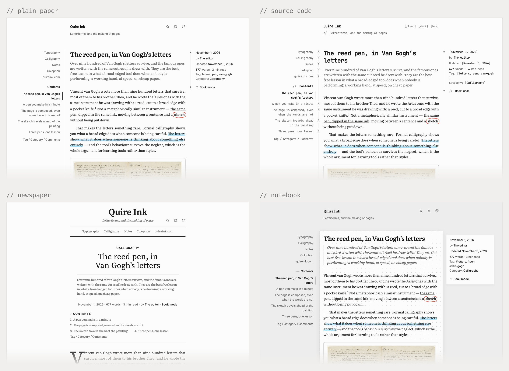
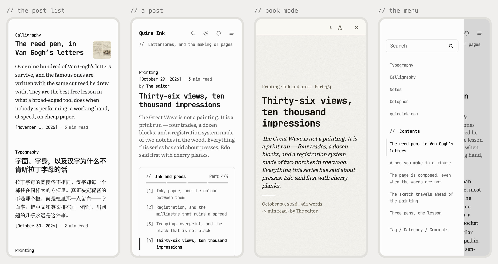
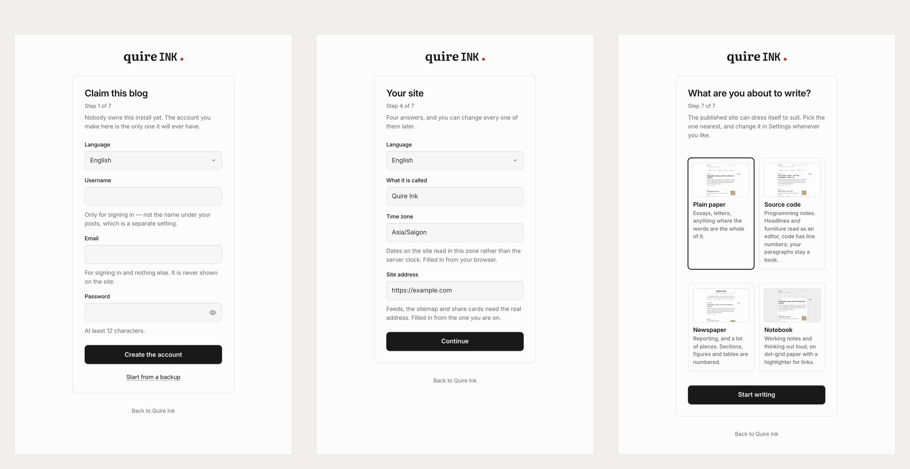

<div align="center">

<picture>
  <source media="(prefers-color-scheme: dark)" srcset="docs/brand/wordmark-dark.svg">
  
</picture>

`2.2.23`

**A self-hosted blog that an AI agent can run for you.**
Your posts are stored in two SQLite files on your own disk and served by one small process. No cloud account needed.
Prefer not to rent a server? It also runs on Cloudflare.

<br/>

 

[**quireink.com**](https://quireink.com) · [**Try it**](https://demo.quireink.com) · [**Install**](#install) · [**Docs**](#where-to-go-next) · [**In full**](./docs/overview.md) · [**Changelog**](./CHANGELOG.md) · [**License**](#license)

<a href="https://deploy.workers.cloudflare.com/?url=https://github.com/joiha-steven/quireink/tree/release"><picture><source media="(prefers-color-scheme: dark)" srcset="docs/brand/button-cloudflare-dark.svg"></picture></a>&nbsp;&nbsp;<a href="#install"><picture><source media="(prefers-color-scheme: dark)" srcset="docs/brand/button-server-dark.svg"></picture></a>

<br/>


<sub>**[demo.quireink.com](https://demo.quireink.com)** is a standard install you can use without signing up. The bar at the bottom takes you to the front page, the list, an article, book mode, light and dark, and the admin. That bar is the only addition, and it sits outside the code, so the demo always runs the latest build.</sub>

</div>

## What it is

Quire Ink is a long-term blog for a single writer. You write in the browser and press Publish. The post goes to your site, your feed, your subscribers' inboxes and, if you turn it on, Mastodon.

Your readers see every post, with no algorithm in between and no ads beside it. The software runs on a server you rent, so the rules only change when you change them. One button exports everything as a folder of Markdown that any editor can open.

The first setup is a technical task: ask someone who knows servers, or hand it to an AI agent. After that, you write from a laptop or a phone. Only upgrades need a terminal.

**Built for** one person, one server and one blog for the long run. **Not built for** teams that need roles, approvals and an editorial queue.

## Features

**Reading themes.** Four themes (plain paper, source code, newspaper and notebook), six palettes with a light and a dark version each, and four reading fonts. Any post can open as a book, set in two columns like a printed page. Size, colour and spacing are all settings, and an automatic check keeps the stylesheet consistent with them.

**The pen.** Highlight in five inks, underline in pencil or circle a word in ballpoint. Each stroke has its own hand-drawn shape. Readers can use the pen too, in their own browser, with no account. It adds 4.5 KB to a post.

**Built-in MCP server.** An assistant can draft, schedule and publish posts, read your traffic, clear spam, rearrange the front page, and build and install a theme. It goes through the same checks as the admin, and a read-only token stays read-only.

**Themes from anyone.** A theme is a zip of CSS, fonts and images, with no code inside. The theme kit checks it, screenshots every page at three widths, and gives clear error reports with the line and a suggested fix. [Start here](docs/themes.md).

**Import and export.** Posts from WordPress, Ghost, Substack and Medium arrive with their images, and their old links keep working. Export is one button. Before each release ships, a real backup is restored and verified table by table and file by file.

**Lightweight.** One process and two SQLite files, with no database server to manage. It runs in 256 MB of memory, so the cheapest server you can rent is enough, and readers download single-digit kilobytes of JavaScript.

**Privacy.** Analytics use no cookies, comments need no account and no third party, and the newsletter is sent through your own mail server. You can add a passkey alongside your password and code; it never replaces them.

**Editor and languages.** Tables, footnotes, callouts, maths, galleries and video, all on top of plain Markdown. The editor saves as you type, keeps versions and schedules posts. The admin and the site come in eleven languages, and each post can set its own.

**Testing.** Nearly 6,000 tests and more than 300 browser flows run on every push. Before a release is published, it is installed fresh and upgraded on every install path listed below.

Every part in detail, with comparisons to the alternatives: [**Quire Ink, in full**](./docs/overview.md).

## A look around



<sub>**The four themes.** The same post as plain paper, source code, a newspaper and a notebook. A theme sets layout, type and marks; colour always comes from the palette.</sub>


<sub>**Book mode and the dark theme.** Any post opens as a paginated book that starts on a title page. Every palette has a light and a dark version.</sub>


<sub>**Maths, code and the pen.** Formulas are real MathML, code is highlighted on the server, and the pen highlights, underlines and circles words in a hand-drawn style.</sub>


<sub>**Reader marks.** A reader's marks stay in their own browser, and sync to their other devices only if they choose to.</sub>



<sub>**On a phone,** the list, a post with its series bar, book mode and the menu drawer with search on top.</sub>


<sub>**The admin.** Home, the writing list, the editor, and the appearance settings, where you change the look of the site without touching code.</sub>



<sub>**Setup** is seven short screens in the browser. The last one picks the theme, then the editor opens.</sub>

## Install

**Try it first, with nothing to install:** [demo.quireink.com](https://demo.quireink.com), or a temporary blog of your own at [try.quireink.com](https://try.quireink.com), reset twice an hour.

Then pick the option that matches what you already have. Each one installs the same blog.

### No server: on Cloudflare <sup>beta</sup>

About five minutes, and **$5 a month** for Cloudflare's Workers Paid plan, which covers every blog in the account. The Free plan caps a blog at 100,000 requests a day, so Workers Paid is the one to use ([why](./docs/self-host-cloudflare.md)).

<a href="https://deploy.workers.cloudflare.com/?url=https://github.com/joiha-steven/quireink/tree/release"><picture><source media="(prefers-color-scheme: dark)" srcset="docs/brand/button-cloudflare-dark.svg"></picture></a>

1. Press the button and sign in to Cloudflare and GitHub. Cloudflare copies Quire Ink into your GitHub and builds it.
2. When the form asks for a **setup code**, choose one of twelve characters or more.
3. Open your blog's address with `/setup` at the end, enter the code, and go through seven short screens.

**Updating:** first, in **Settings → Server → Advanced → Cloudflare**, add the update workflow to your copy (one click, then *Commit*). After that, each update is one click in your copy's **Actions** tab.

**Already running Quire Ink on a server?** In its admin, **Settings → Server → Advanced → Run on Cloudflare** moves it there, posts and pictures included. The rest is in [the Cloudflare guide](./docs/self-host-cloudflare.md).

### A rented server (VPS): one command

Ubuntu or Debian (the cheapest tier is enough) and a domain pointing to it. About ten minutes:

```bash
curl -fsSL https://raw.githubusercontent.com/joiha-steven/quireink/main/server.sh \
  | sudo bash -s -- --domain blog.example.com --setup-code 'twelve-or-more-characters'
```

[`server.sh`](./server.sh) installs Docker and runs the newest release with a free HTTPS certificate. To protect what is already there, it only installs on a machine that is not serving anything yet. Then open `https://blog.example.com/setup` and enter the code. **Updating:** `docker compose pull && docker compose up -d` in `/opt/quireink`.

### Something else

| You have | How | Updating |
|:--|:--|:--|
| **A NAS** (Unraid, Synology, QNAP, Runtipi) | Unraid: **Apps → `QuireInk`**. The others: paste one compose file ([step by step](./docs/self-host-docker.md#on-a-nas-or-a-home-server)) | The container app's **Update** |
| **Docker already**, and a domain | [`docker-compose.image.yml`](./docker-compose.image.yml) + the [`Caddyfile`](./Caddyfile) ([how](./docs/self-host-docker.md)) | `docker compose pull && docker compose up -d` |
| **A server you look after yourself**, with Bun 1.3+ | [`install.sh`](./install.sh), then systemd and nginx ([self-hosting](./docs/self-host.md)) | `bun run upgrade` |
| **Kubernetes** | [The manifests](./deploy/kubernetes/README.md) | Change the image tag |
| **A DigitalOcean droplet** | [One pasted file](./deploy/digitalocean/README.md) | As the VPS above |

Every option installs a published release, and each release is tested on all of these paths before it ships ([how](./docs/install.md)). Images are available for `amd64` and `arm64`. An AI agent can also install it for you: the [`quireink-install`](./.claude/skills/quireink-install/SKILL.md) skill walks it through the steps and the checks afterwards.

## Connecting an AI agent

1. Go to **Admin → Settings → Server & connections → Advanced → MCP** and create a token.
2. Point your agent at `https://<your-domain>/api/mcp` with `Authorization: Bearer <token>`.
3. Ask it for a post, a Monday traffic report or a newsletter draft. [The agent cookbook](./docs/agent-cookbook.md) has ready-to-use prompts for real tasks; see also [how MCP works here](./docs/mcp.md).

## Where to go next

| You want to | Read |
|---|---|
| Install by hand, put it behind a CDN, upgrade | [Self-hosting](./docs/self-host.md) · [Docker](./docs/self-host-docker.md) · [Environment variables](./docs/environment.md) |
| Change how the site looks, or add your own CSS | [Appearance](./docs/appearance.md) |
| Back it up and restore it | [Backups](./docs/backups.md) |
| Let an agent run it | [MCP](./docs/mcp.md) · [Cookbook](./docs/agent-cookbook.md) |
| Read it from another program | [Content API](./docs/content-api.md) |
| Translate it | [Translations](./docs/translations.md) |
| Know how it is built and why | [docs/](./docs/README.md) · [decisions](./docs/decisions/README.md) |

## Develop

```bash
bun install
bun run build:admin                 # once, and again whenever src/admin changes
bun run dev                         # http://localhost:3000
# the log prints a /setup link to claim it; or: bun run user create --username me --email me@example.com
```

A change is ready when `bun run check:all` passes. It runs two typechecks, the static guards and the tests, offline, with no credentials or external services. `bun run tour` then visits every screen in a real browser and restores the backup it made. Start at [`CONTRIBUTING.md`](./CONTRIBUTING.md), which points to the house rules in [`CLAUDE.md`](./CLAUDE.md).

<details>
<summary><b>Where things live</b></summary>

| Where | What is in it |
|---|---|
| `src/` | The application: Bun, Hono, SQLite. [How the pieces fit](./docs/spec/02-structure.md) |
| `docs/` | How it works and why. [`docs/README.md`](./docs/README.md) indexes it; [`docs/decisions/`](./docs/decisions/README.md) is every decision, including the ones that were reversed |
| `golden/` | The rendering contract. The build compares output against it byte for byte, so rendering stays stable from release to release |
| `scripts/checks/` | The static guards. They keep every write route inside the owner-only group and every font size in the reader's stylesheet tied to a setting |

Plans live in the author's private notes rather than here: they describe one person's intentions for one blog, not commitments to anyone running the software ([ADR 0017](./docs/decisions/0017-move-state-and-instance-config-private.md)).

</details>

## License

**The code here** is [GNU AGPL v3.0 only](./LICENSE). Open source. In short: **use it, change it, host it, sell it. If you run a changed version for other people, offer them its source.**

- **Anything you like, for free.** Your own blog, a client's, a business, a hosting service. Read it, change it, fork it, pass it on.
- **Changed it and run it for others? Share the change.** If people use your modified Quire Ink over the network, you must offer them the source of that version (AGPL §13). Running it unmodified asks nothing more of you.
- **What you write stays yours.** Your posts and images are not covered by the code licence and are not in this repository.

> **Older releases keep their own terms.** Everything up to and including v2.0.0 is MIT. Later releases up to v2.2.22 are
> PolyForm Noncommercial plus the [additional permission](https://github.com/joiha-steven/quireink/blob/v2.2.22/LICENSE-EXCEPTION.md)
> they shipped with. A licence change does not reach backwards ([ADR 0075](./docs/decisions/0075-relicense-agpl.md)).

## About this project

**Written by someone who does not code.** Every line of Quire Ink is written by Claude Code; I have no software background. I do have time for it, so updates come often. Every change passes the test suite and a browser tour of every screen before it ships, and the same build runs the demo and my own blog. Bugs still happen, so please [open an issue](https://github.com/joiha-steven/quireink/issues) when you find one: that is how I learn about them.
