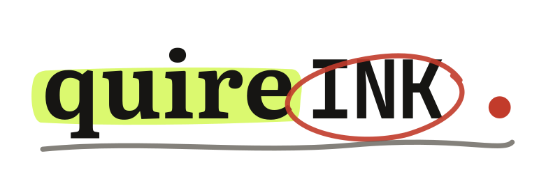
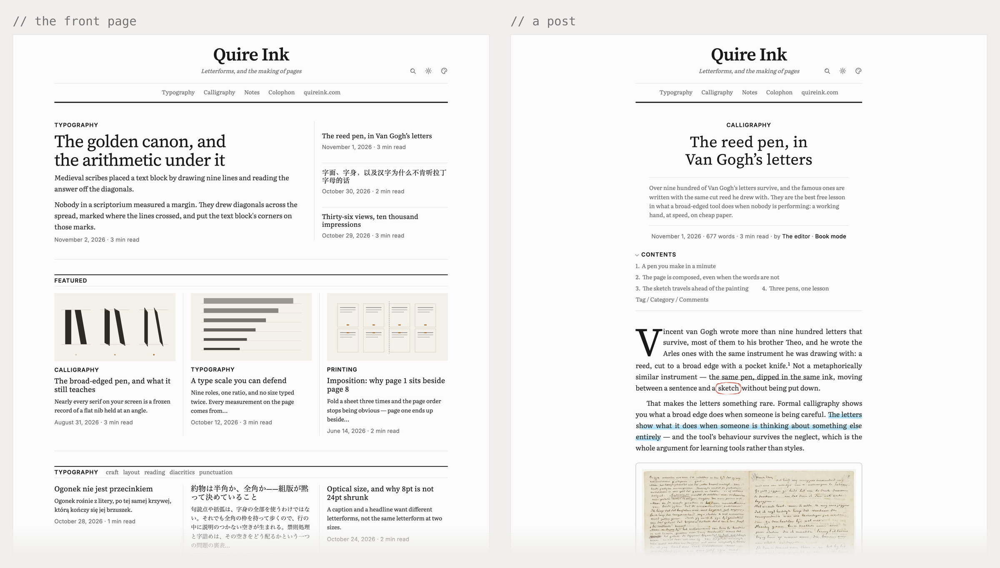
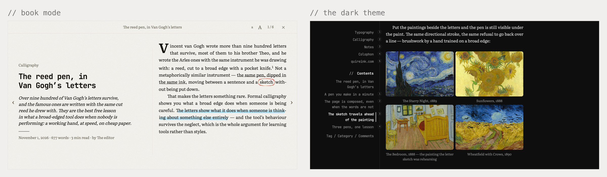
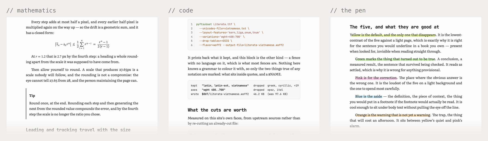
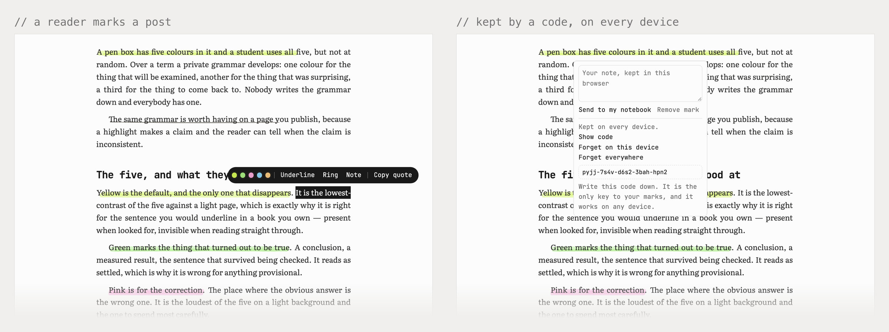
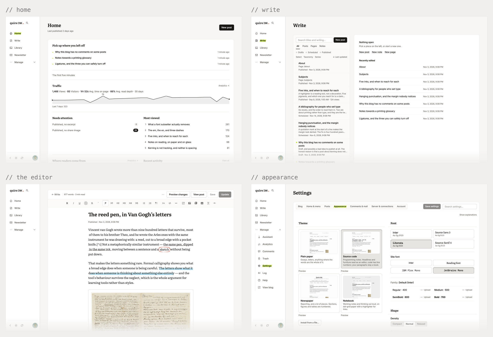

<div align="center">

<picture>
  <source media="(prefers-color-scheme: dark)" srcset="docs/brand/wordmark-dark.svg">
  
</picture>

`2.2.22`

**A self-hosted blog that an AI agent can run for you.**
Your posts live in two SQLite files on your own disk, served by one small process that needs no cloud account.
If you would rather not rent a server, it also runs on Cloudflare.

<br/>

 

[**quireink.com**](https://quireink.com) · [**Try it**](https://demo.quireink.com) · [**Install**](#install) · [**Docs**](#where-to-go-next) · [**In full**](./docs/overview.md) · [**Changelog**](./CHANGELOG.md) · [**License**](#license)

<a href="https://deploy.workers.cloudflare.com/?url=https://github.com/joiha-steven/quireink/tree/release"><picture><source media="(prefers-color-scheme: dark)" srcset="docs/brand/button-cloudflare-dark.svg"></picture></a>&nbsp;&nbsp;<a href="#install"><picture><source media="(prefers-color-scheme: dark)" srcset="docs/brand/button-server-dark.svg"></picture></a>

<br/>



<sub>**[demo.quireink.com](https://demo.quireink.com)** is a normal install you can use without signing up. The bar at the bottom jumps between the front page, the list, an article, book mode, light and dark, and the admin. The bar is the only addition and lives outside the code, so the demo always runs the latest build.</sub>

</div>

## What it is

Quire Ink is a blog for one person who means to keep writing for years. You write in the browser and press publish, and the post goes to your site, your feed, your subscribers' inboxes and, if you switch it on, Mastodon.

No algorithm decides who sees a post and no ads run beside it. Because the software runs on a server you rent, nobody can change the rules on you next year, and one button exports everything as a folder of Markdown that any editor can open.

The first setup is a technical job: ask someone who knows servers, or hand it to an AI agent. After that you write from a laptop or a phone, and only upgrades need a terminal.

**Made for** one person, one server, one blog they mean to keep. **Not made for** a team that needs roles, approvals and an editorial queue.

## Features

**Reading themes.** Four themes (plain paper, source code, newspaper and notebook) in six palettes, each with a light and a dark version, and four reading fonts. Any post can open as a book, set in two columns like a printed page. Size, colour and spacing are settings; a build check rejects any of them written into the stylesheet by hand.

**The pen.** Highlight in five inks, underline in pencil or ring a word in ballpoint, and each stroke gets its own hand-drawn shape. Readers can use the pen too, in their own browser and without an account. It adds 4.5 KB to a post.

**Built-in MCP server.** An assistant can draft, schedule and publish posts, read your traffic, sweep spam, rearrange the front page, and build and install a theme. Its calls pass the same checks as the admin's, and a read-only token stays read-only.

**Themes from anyone.** A theme is a zip of CSS, fonts and images with no code in it. The theme kit checks yours, screenshots it on every page at three widths, and reports which line is wrong along with what to write instead. [Start here](docs/themes.md).

**Import and export.** Posts from WordPress, Ghost, Substack and Medium come across with their images, and their old links keep working. Exporting is one button. Before each release ships, a real backup is restored and checked table by table and file by file.

**Small footprint.** One process and two SQLite files, with no database server. It runs in 256 MB of memory, which fits the cheapest server you can rent, and readers download single-digit kilobytes of JavaScript.

**Privacy.** Analytics use no cookies, comments need no account and no third party, and the newsletter goes out through your own mail server. A passkey can be added alongside your password and code but never replaces them.

**Editor and languages.** Tables, footnotes, callouts, maths, galleries and video on top of plain Markdown. The editor saves as you type, keeps versions and schedules posts. The admin and the site are available in eleven languages, and each post can set its own.

**Testing.** Nearly 6,000 tests and more than 300 browser flows run on every push. Before a release is published, it is installed fresh and upgraded on every install path listed below.

Every part in detail, with comparisons to the alternatives: [**Quire Ink, in full**](./docs/overview.md).

## A look around


<sub>**The four themes.** The same post as plain paper, source code, a newspaper and a notebook. A theme sets shape, type and marks; colour always comes from the palette.</sub>



<sub>**Book mode and the dark theme.** Any post opens as a paginated book that starts on a title page. Every palette has a light and a dark version.</sub>



<sub>**Maths, code and the pen.** Formulas are real MathML, code is highlighted on the server, and the pen highlights, underlines and rings words by hand.</sub>



<sub>**Reader marks.** A reader's marks stay in their own browser and sync to their other devices only if they ask for it.</sub>


<sub>**On a phone,** the list, a post with its series bar, book mode and the menu drawer with search on top.</sub>



<sub>**The admin.** Home, the writing list, the editor, and the appearance settings, where the look of the site is changed without touching code.</sub>


<sub>**Setup** takes seven short screens in the browser. The last one picks the theme, and then the editor opens.</sub>

## Install

**Try it first, nothing to install:** [demo.quireink.com](https://demo.quireink.com), or your own throwaway blog at [try.quireink.com](https://try.quireink.com), wiped twice an hour.

Then pick the option that matches what you already have. Each one installs the same blog.

### No server: on Cloudflare <sup>beta</sup>

About five minutes, and **$5 a month** for Cloudflare's Workers Paid plan, which covers every blog in the account. The Free plan is not enough: it stops a blog at 100,000 requests a day ([why](./docs/self-host-cloudflare.md)).

<a href="https://deploy.workers.cloudflare.com/?url=https://github.com/joiha-steven/quireink/tree/release"><picture><source media="(prefers-color-scheme: dark)" srcset="docs/brand/button-cloudflare-dark.svg"></picture></a>

1. Press the button and sign in to Cloudflare and GitHub. Cloudflare copies Quire Ink into your GitHub and builds it.
2. When the form asks for a **setup code**, make one up: twelve characters or more.
3. Open your blog's address with `/setup` on the end, type the code, and answer seven short screens.

**Updating:** once, in **Settings → Server → Advanced → Cloudflare**, add the update workflow to your copy (one click, then *Commit*). After that, each update is one click in your copy's **Actions** tab.

**Already running Quire Ink on a server?** In its admin, **Settings → Server → Advanced → Run on Cloudflare** moves it there, posts and pictures included. Everything else is in [the Cloudflare guide](./docs/self-host-cloudflare.md).

### A rented server (VPS): one command

Ubuntu or Debian (the cheapest tier is enough) and a domain pointed at it. About ten minutes:

```bash
curl -fsSL https://raw.githubusercontent.com/joiha-steven/quireink/main/server.sh \
  | sudo bash -s -- --domain blog.example.com --setup-code 'twelve-or-more-characters'
```

[`server.sh`](./server.sh) installs Docker, runs the newest release with a free HTTPS certificate, and refuses a machine that already serves something. Then open `https://blog.example.com/setup` and type the code. **Updating:** `docker compose pull && docker compose up -d` in `/opt/quireink`.

### Something else

| You have | How | Updating |
|:--|:--|:--|
| **A NAS** (Unraid, Synology, QNAP, Runtipi) | Unraid: **Apps → `QuireInk`**. The others: paste one compose file ([step by step](./docs/self-host-docker.md#on-a-nas-or-a-home-server)) | The container app's **Update** |
| **Docker already**, and a domain | [`docker-compose.image.yml`](./docker-compose.image.yml) + the [`Caddyfile`](./Caddyfile) ([how](./docs/self-host-docker.md)) | `docker compose pull && docker compose up -d` |
| **A server you look after yourself**, with Bun 1.3+ | [`install.sh`](./install.sh), then systemd and nginx ([self-hosting](./docs/self-host.md)) | `bun run upgrade` |
| **Kubernetes** | [The manifests](./deploy/kubernetes/README.md) | Change the image tag |
| **A DigitalOcean droplet** | [One pasted file](./deploy/digitalocean/README.md) | As the VPS above |

Every way installs a published release, tried on each of these paths before it ships ([how](./docs/install.md)). Images exist for `amd64` and `arm64`. An AI agent can also do the install for you: the [`quireink-install`](./.claude/skills/quireink-install/SKILL.md) skill takes it through the steps and the checks afterwards.

## Connecting an AI agent

1. **Admin → Settings → Server & connections → Advanced → MCP**, and create a token.
2. Point your agent at `https://<your-domain>/api/mcp` with `Authorization: Bearer <token>`.
3. Ask it for a post, a Monday traffic report or a newsletter draft. [The agent cookbook](./docs/agent-cookbook.md) has prompts that do real jobs; [how MCP works here](./docs/mcp.md).

## Where to go next

| You want to | Read |
|---|---|
| Install by hand, put it behind a CDN, upgrade | [Self-hosting](./docs/self-host.md) · [Docker](./docs/self-host-docker.md) · [Environment variables](./docs/environment.md) |
| Change how the site looks, or add your own CSS | [Appearance](./docs/appearance.md) |
| Back it up and restore it | [Backups](./docs/backups.md) |
| Let an agent run it | [MCP](./docs/mcp.md) · [Cookbook](./docs/agent-cookbook.md) |
| Read it from another program | [Content API](./docs/content-api.md) |
| Translate it | [Translations](./docs/translations.md) |
| Know how it is built and why | [docs/](./docs/README.md) · [decisions](./docs/decisions/README.md) |

## Develop

```bash
bun install
bun run build:admin                 # once, and again whenever src/admin changes
bun run dev                         # http://localhost:3000
# the log prints a /setup link to claim it; or: bun run user create --username me --email me@example.com
```

A change is done when `bun run check:all` passes. It runs two typechecks, the static guards and the tests, offline and without credentials or external services. `bun run tour` then drives every screen in a real browser and restores the backup it made. Start at [`CONTRIBUTING.md`](./CONTRIBUTING.md), which points to the house rules in [`CLAUDE.md`](./CLAUDE.md).

<details>
<summary><b>Where things live</b></summary>

| Where | What is in it |
|---|---|
| `src/` | The application: Bun, Hono, SQLite. [How the pieces fit](./docs/spec/02-structure.md) |
| `docs/` | How it works and why. [`docs/README.md`](./docs/README.md) indexes it; [`docs/decisions/`](./docs/decisions/README.md) is every decision, including the ones that were reversed |
| `golden/` | The rendering contract. One byte of different output fails the build |
| `scripts/checks/` | The static guards. A write route registered outside the owner-only group stops the build, and so does a hardcoded font size in the reader's stylesheet |

Plans are kept in the author's private notes rather than here: they are one person's intentions for one blog, not commitments to anyone running the software ([ADR 0017](./docs/decisions/0017-move-state-and-instance-config-private.md)).

</details>

## License

**The code here** is [PolyForm Noncommercial 1.0.0](./LICENSE) plus [one additional permission](./LICENSE-EXCEPTION.md). Source-available, not open source. In short: **you may run it, and charge for running it, as long as you run a version published here.**

- **Noncommercial: everything.** Your own blog, a hobby project, study, research, and also charities, schools, public research bodies and government. Read it, change it, host it, fork it, pass it on.
- **Commercial: yes, unmodified.** Run it for a business or a client, sell hosting where each customer gets their own blog. Four things are asked in return: run a published release with its source unchanged, keep the notices, say your service runs Quire Ink and link back, and sell the service rather than the software. Settings, palettes, fonts and content are not source, so changing them to alter how a site looks does not count as a modification.
- **A modified version, used commercially, needs a separate licence.** Fixing a bug or a security hole in your own deployment is exempt: patch it, and tell the owner within 30 days.
- **What you write stays yours.** Your posts and images are not covered by the code licence and are not in this repository.
- **After 48 months without a release, it opens.** The code as it stands at that point also becomes available to you under the Apache License 2.0, through a grant made today. Nobody has to be reachable for that to take effect ([ADR 0050](./docs/decisions/0050-the-licence-opens-by-itself-after-48-months-without-a-release.md)).

> **Everything up to and including v2.0.0 was MIT, and stays MIT forever.** A licence change
> does not reach backwards ([ADR 0015](./docs/decisions/0015-relicense-polyform-noncommercial.md)).

## About this project

**Written by someone who cannot code.** Every line of Quire Ink is Claude Code's work; I have no software background. What I do have is time for it, so updates come often. Every change goes through the test suite and a browser tour of every screen before it ships, and it runs the demo and my own blog. Bugs still happen: [open an issue](https://github.com/joiha-steven/quireink/issues), because being told is how I find out.
