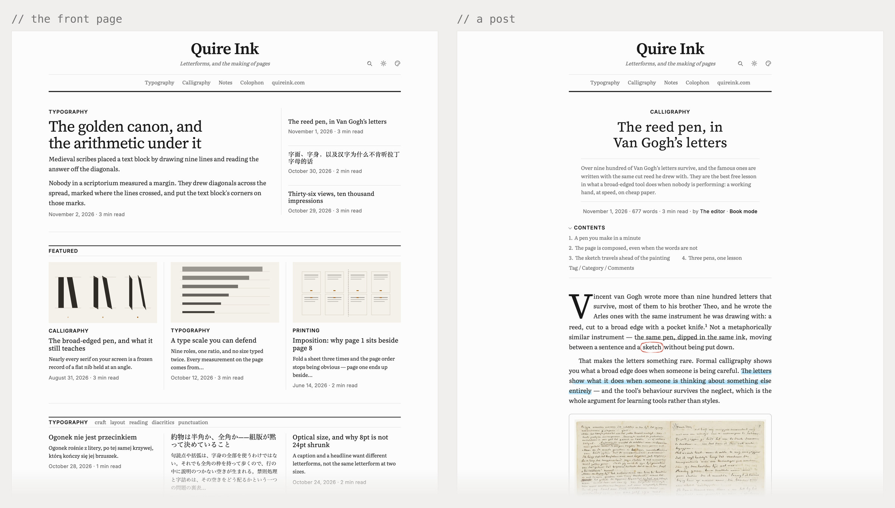
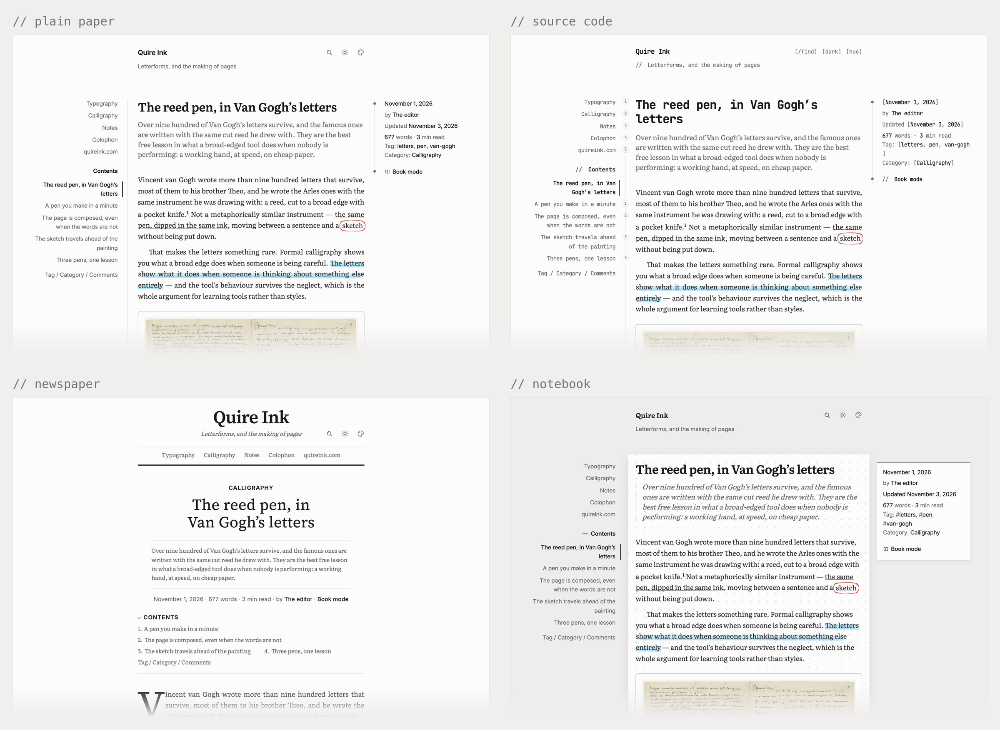
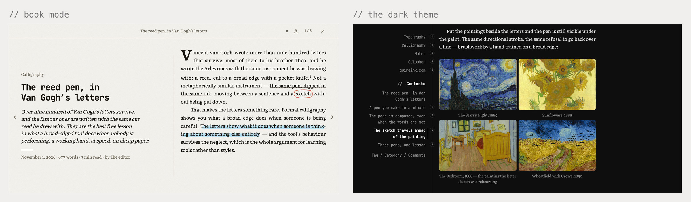
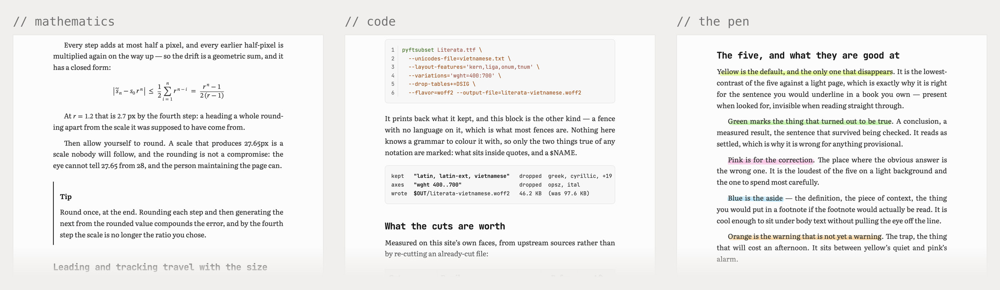
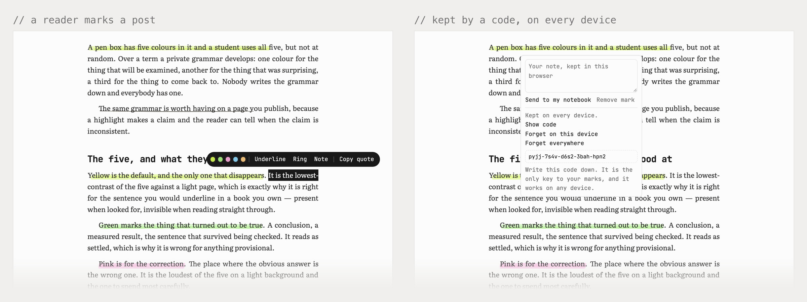
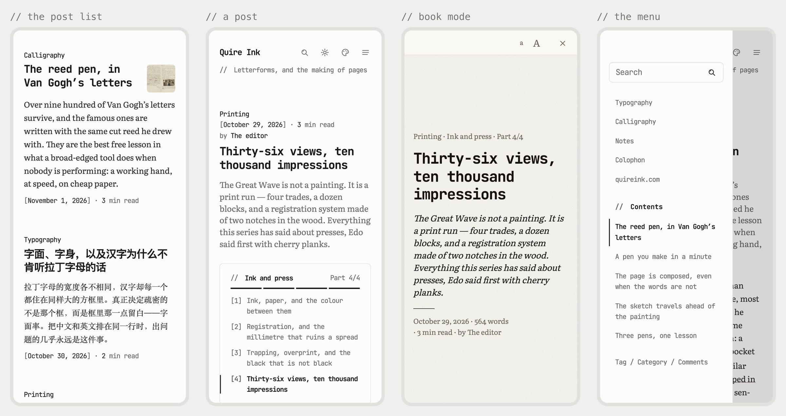
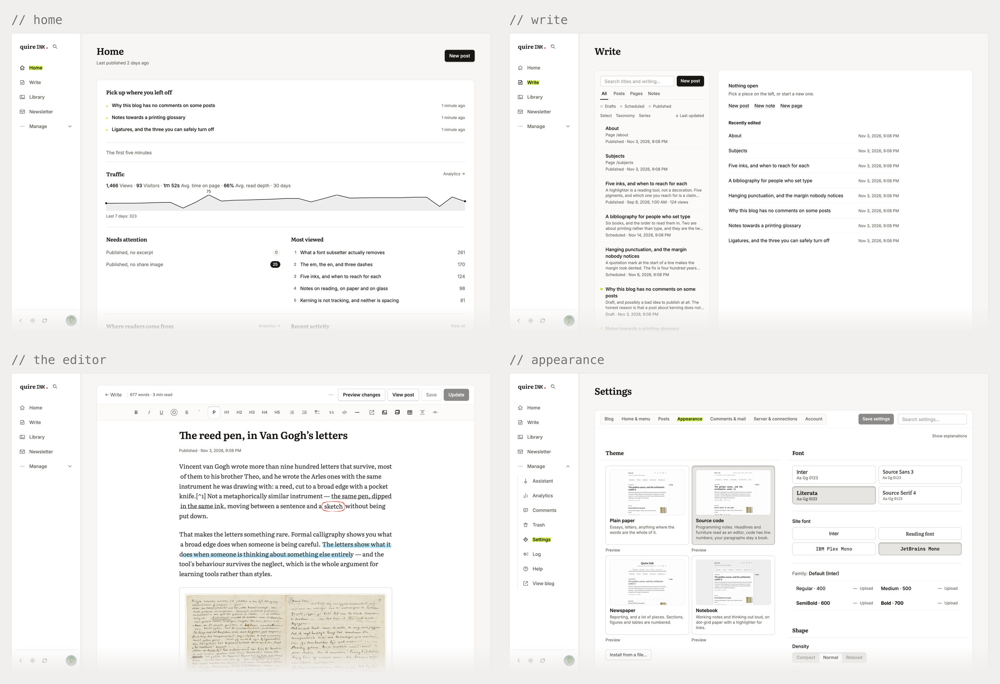
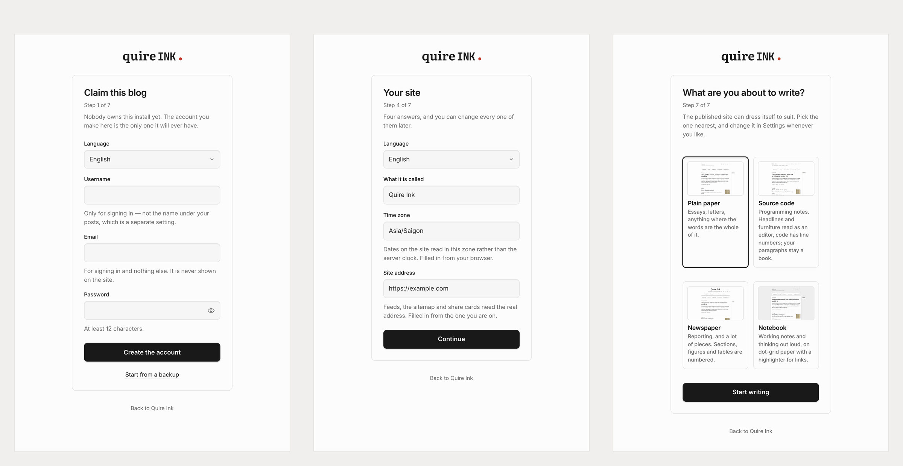

<div align="center">

<picture>
  <source media="(prefers-color-scheme: dark)" srcset="docs/brand/wordmark-dark.svg">
  
</picture>

`2.2.21`

**A blog you keep. An AI agent can run it for you.**
No algorithm, no ads, no platform between you and your readers.
Your writing is two files on your own disk, in one small process that needs no cloud account. Cloudflare is there if you would rather not rent a server.

<br/>

 

[**quireink.com**](https://quireink.com) · [**Try it**](https://demo.quireink.com) · [**Install**](#install) · [**Docs**](#where-to-go-next) · [**In full**](./docs/overview.md) · [**Changelog**](./CHANGELOG.md) · [**License**](#license)

<a href="https://deploy.workers.cloudflare.com/?url=https://github.com/joiha-steven/quireink/tree/release"><picture><source media="(prefers-color-scheme: dark)" srcset="docs/brand/button-cloudflare-dark.svg"></picture></a>&nbsp;&nbsp;<a href="#install"><picture><source media="(prefers-color-scheme: dark)" srcset="docs/brand/button-server-dark.svg"></picture></a>

<br/>



<sub>**[demo.quireink.com](https://demo.quireink.com)** is the real thing. No sign-up, nothing to fill in. The bar at the bottom jumps between the front page, the list, an article, book mode, light and dark, and the admin. That bar is the only thing added, and it lives outside the code, so the demo is always the latest build.</sub>

</div>

## What it is

Quire Ink is a blog for one person who means to keep writing for years. You write in the browser and press publish. The post goes to your site, your feed and your subscribers' inboxes, and to Mastodon if you switch that on.

Nobody decides who sees it, nothing runs ads across it, and nobody can change the rules next year. Your writing sits on a server you rent, and one button turns it into a folder of Markdown any editor can open.

The first setup is a technical job, so ask someone who knows servers, or hand it to an AI agent. After that you write, from a laptop or a phone, and only an upgrade sends you back to a terminal.

**Made for** one person, one server, one blog they mean to keep. **Not made for** a team that needs roles, approvals and an editorial queue.

## Why people pick it

**The reading page is the product.** Plain paper, source code, a newspaper or a notebook, in six palettes, light and dark, with four reading fonts. Any post opens as a book, set in two columns like paper. Size, colour and spacing are settings, and the build fails if anyone writes one into the stylesheet by hand.

**A pen that looks drawn.** Highlight in five inks, underline in pencil, ring a word in ballpoint, and no two strokes share a shape. Your readers get the pen too, in their own browser, with no account, for 4.5 KB on a post.

**An agent can run the blog, not just write in it.** The MCP server is built in. An assistant drafts, schedules and publishes, reads your numbers, sweeps spam, rearranges the front page, and can build and install a theme. It goes through the same checks the admin does, and a read-only token stays read-only.

**Anyone can make a theme.** A theme is CSS, fonts and images in a zip, with no code in it. The kit checks yours, photographs it on every page at three widths, and tells you which line is wrong and what to write instead. [Start here](docs/themes.md).

**You can always leave, and you can move in today.** WordPress, Ghost, Substack and Medium come across with their pictures, and old links keep working. Out is one button. Every release restores a real backup, table by table and file by file, before it ships, because a backup nobody has restored is not a backup.

**Small enough to forget about.** One process and two SQLite files, with no database server. It runs in 256 MB of memory, and a reader downloads single-digit kilobytes of JavaScript. It really does run on the cheapest server you can rent.

**Nothing watches your readers.** Analytics without cookies, comments with no account and no third party, a newsletter through your own mail server. Sign in with a passkey beside your password and code, never in place of them.

**A real editor, in eleven languages.** Tables, footnotes, callouts, maths, galleries and video over plain Markdown. It saves as you type, keeps versions and schedules. The admin and the site speak eleven languages, and a single post can name its own.

**Tested the hard way.** Nearly 6,000 tests and more than 300 flows in a real browser on every push. Each release is installed fresh and upgraded on every path in this page before it is published.

Every part in detail, and against the alternatives: [**Quire Ink, in full**](./docs/overview.md).

## A look around



<sub>**Four themes, one click.** The same post as plain paper, source code, a newspaper and a notebook. A theme sets shape, type and marks, and the colour always comes from the palette.</sub>



<sub>**Book mode and the dark theme.** Any post opens as a paginated book that starts on a title page; every palette is drawn twice, once for light and once for dark.</sub>



<sub>**Maths, code and the pen.** Formulas are real MathML, code is highlighted on the server, and the pen highlights, underlines and rings words by hand.</sub>



<sub>**Readers get the pen too.** Their marks stay in their own browser, and travel between their devices only if they ask.</sub>



<sub>**On a phone,** the list, a post with its series bar, book mode and the menu drawer with search on top.</sub>



<sub>**The admin.** Home, the writing list, the editor and the settings that decide how the site looks. All of it a setting, none of it code.</sub>



<sub>**Setting up** is seven short screens in the browser, ending on the theme, and then you are in the editor.</sub>

## Install

**Try it first, nothing to install:** [demo.quireink.com](https://demo.quireink.com), or your own throwaway blog at [try.quireink.com](https://try.quireink.com), wiped twice an hour.

Then pick the way that matches what you have. All of them end at the same blog.

### No server: on Cloudflare <sup>beta</sup>

About five minutes, and **$5 a month** for Cloudflare's Workers Paid plan, which covers every blog in the account. The Free plan is not enough: it stops a blog at 100,000 requests a day ([why](./docs/self-host-cloudflare.md)).

<a href="https://deploy.workers.cloudflare.com/?url=https://github.com/joiha-steven/quireink/tree/release"><picture><source media="(prefers-color-scheme: dark)" srcset="docs/brand/button-cloudflare-dark.svg"></picture></a>

1. Press the button and sign in to Cloudflare and GitHub. Cloudflare copies Quire Ink into your GitHub and builds it.
2. When the form asks for a **setup code**, make one up: twelve characters or more.
3. Open your blog's address with `/setup` on the end, type the code, and answer seven short screens.

**Updating:** once, in **Settings → Server → Advanced → Cloudflare**, add the update workflow to your copy (one click, then *Commit*). After that, each update is one click in your copy's **Actions** tab.

**Already running Quire Ink on a server?** In its admin, **Settings → Server → Advanced → Run on Cloudflare** moves it there, posts and pictures included. Everything else is in [the Cloudflare guide](./docs/self-host-cloudflare.md).

### A rented server (VPS): one command

Ubuntu or Debian (the cheapest tier is enough) and a domain pointed at it. About ten minutes:

```bash
curl -fsSL https://raw.githubusercontent.com/joiha-steven/quireink/main/server.sh \
  | sudo bash -s -- --domain blog.example.com --setup-code 'twelve-or-more-characters'
```

[`server.sh`](./server.sh) installs Docker, runs the newest release with a free HTTPS certificate, and refuses a machine that already serves something. Then open `https://blog.example.com/setup` and type the code. **Updating:** `docker compose pull && docker compose up -d` in `/opt/quireink`.

### Something else

| You have | How | Updating |
|:--|:--|:--|
| **A NAS** (Unraid, Synology, QNAP, Runtipi) | Unraid: **Apps → `QuireInk`**. The others: paste one compose file ([step by step](./docs/self-host-docker.md#on-a-nas-or-a-home-server)) | The container app's **Update** |
| **Docker already**, and a domain | [`docker-compose.image.yml`](./docker-compose.image.yml) + the [`Caddyfile`](./Caddyfile) ([how](./docs/self-host-docker.md)) | `docker compose pull && docker compose up -d` |
| **A server you look after yourself**, with Bun 1.3+ | [`install.sh`](./install.sh), then systemd and nginx ([self-hosting](./docs/self-host.md)) | `bun run upgrade` |
| **Kubernetes** | [The manifests](./deploy/kubernetes/README.md) | Change the image tag |
| **A DigitalOcean droplet** | [One pasted file](./deploy/digitalocean/README.md) | As the VPS above |

Every way installs a published release, tried on each of these paths before it ships ([how](./docs/install.md)). Images exist for `amd64` and `arm64`. **Rather not do it yourself?** Hand the server to an AI agent: the [`quireink-install`](./.claude/skills/quireink-install/SKILL.md) skill walks it through, checks included.

## Let an AI agent write for you

1. **Admin → Settings → Server & connections → Advanced → MCP**, and create a token.
2. Point your agent at `https://<your-domain>/api/mcp` with `Authorization: Bearer <token>`.
3. Ask it for a post, a Monday traffic report or a newsletter draft. [The agent cookbook](./docs/agent-cookbook.md) has prompts that do real jobs; [how MCP works here](./docs/mcp.md).

## Where to go next

| You want to | Read |
|---|---|
| Install by hand, put it behind a CDN, upgrade | [Self-hosting](./docs/self-host.md) · [Docker](./docs/self-host-docker.md) · [Environment variables](./docs/environment.md) |
| Change how the site looks, or add your own CSS | [Appearance](./docs/appearance.md) |
| Back it up and restore it | [Backups](./docs/backups.md) |
| Let an agent run it | [MCP](./docs/mcp.md) · [Cookbook](./docs/agent-cookbook.md) |
| Read it from another program | [Content API](./docs/content-api.md) |
| Translate it | [Translations](./docs/translations.md) |
| Know how it is built and why | [docs/](./docs/README.md) · [decisions](./docs/decisions/README.md) |

## Develop

```bash
bun install
bun run build:admin                 # once, and again whenever src/admin changes
bun run dev                         # http://localhost:3000
# the log prints a /setup link to claim it; or: bun run user create --username me --email me@example.com
```

Nothing is finished until `bun run check:all` passes: two typechecks, the static guards and the tests, all offline, with no credentials and no services. `bun run tour` then drives every screen in a real browser and opens the backup it built. Start at [`CONTRIBUTING.md`](./CONTRIBUTING.md), which points to the house rules in [`CLAUDE.md`](./CLAUDE.md).

<details>
<summary><b>Where things live</b></summary>

| Where | What is in it |
|---|---|
| `src/` | The whole thing: Bun, Hono, SQLite. [How the pieces fit](./docs/spec/02-structure.md) |
| `docs/` | How it works and why. [`docs/README.md`](./docs/README.md) indexes it; [`docs/decisions/`](./docs/decisions/README.md) is every decision, including the ones that were reversed |
| `golden/` | The rendering contract. One byte of different output fails the build |
| `scripts/checks/` | The guards. Register a write route outside the owner-only group and the build stops, same as a hardcoded font size in the reader's stylesheet |

What is planned lives with the author's own notes rather than here, because it is one person's intentions for one blog and not a promise to anybody running the software ([ADR 0017](./docs/decisions/0017-move-state-and-instance-config-private.md)).

</details>

## License

**The code here** is [PolyForm Noncommercial 1.0.0](./LICENSE) plus [one additional permission](./LICENSE-EXCEPTION.md). Source-available, not open source. Together they come to one sentence: **run it, and charge for running it, as long as the version you run is the one published here.**

- **Noncommercial: everything.** Your own blog, a hobby project, study, research, and also charities, schools, public research bodies and government. Read it, change it, host it, fork it, pass it on.
- **Commercial: yes, unmodified.** Run it for a business or a client, sell hosting where each customer gets their own blog. Four things are asked in return: run a published release with its source unchanged, keep the notices, say your service runs Quire Ink and link back, and sell the service rather than the software. Settings, palettes, fonts and content are not source, so the look of a site is a setting here rather than a fork.
- **A modified version, used commercially, needs a separate licence.** That is the one line the project holds. Fixing a bug or a security hole in your own deployment is carved out; patch it, and tell the owner within 30 days.
- **What you write stays yours.** Your posts and images are not covered by the code licence and are not in this repository.
- **If the project ever goes quiet, it opens.** Forty-eight months without a release and the code as it then stands is also yours under the Apache License 2.0, by a grant already made today. Nobody has to be reachable for that to happen ([ADR 0050](./docs/decisions/0050-the-licence-opens-by-itself-after-48-months-without-a-release.md)).

> **Everything up to and including v2.0.0 was MIT, and stays MIT forever.** A licence change
> does not reach backwards ([ADR 0015](./docs/decisions/0015-relicense-polyform-noncommercial.md)).

## About this project

**Written by someone who cannot code.** Every line of Quire Ink is Claude Code's work; I have no software background. What I do have is time for it, so updates come often. Every change goes through the test suite and a browser tour of every screen before it ships, and it runs the demo and my own blog. Bugs still happen: [open an issue](https://github.com/joiha-steven/quireink/issues), because being told is how I find out.
